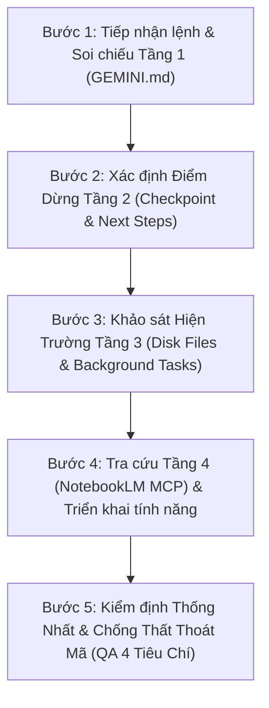

# ART AI: 4-Layer Memory Architecture & Execution Protocol

Kỹ năng này định nghĩa và vận hành **Kiến trúc Bộ nhớ 4 Tầng** độc quyền cho dự án **ART AI (AI Giáo Viên Mĩ Thuật)**. Bất cứ khi nào nhận chỉ thị từ người dùng, tác nhân (Agent) PHẢI tuân thủ đầy đủ quy trình 4 tầng này để duy trì tính liên tục tuyệt đối, không làm mất ngữ cảnh, không tái phát lỗi cũ và đảm bảo chuẩn sư phạm.

---

## 🏛️ Cấu Trúc 4 Tầng Bộ Nhớ

### 📌 Tầng 1: Tệp Quy Tắc Cốt Lõi Vĩnh Cửu (`GEMINI.md`)
* **Vị trí:** `c:\Users\win 10 pro\Downloads\hệ thống nghiên cứu\GEMINI.md`
* **Vai trò:** "Bản hiến pháp" bất biến của dự án, được tự động nạp ở MỌI phiên làm việc.
* **Nguyên tắc bắt buộc kiểm tra:**
  1. **Hình mẫu giáo viên:** 100% "Thầy Giáo Mĩ Thuật" (Thầy Cọ Nhí), sử dụng ảnh chân dung thực tế tại `app/public/teacher.jpg`.
  2. **Chuẩn sư phạm:** GDPT 2018 Mĩ thuật Lớp 1 - 5 (Thông tư 32/2018/TT-BGDĐT), đánh giá bằng Thang Rubric 4 Tiêu chí (Sáng tạo, Bố cục, Kỹ thuật màu/nét, Cảm xúc & Tính hoàn thiện).
  3. **Nguyên tắc giao tiếp:** Không phán xét tiêu cực nét vẽ của học sinh, phản hồi theo phương pháp Sandwich (Khen ngợi -> Gợi ý cải thiện cụ thể -> Thử thách/Huy hiệu).
  4. **Hạ tầng 100% Miễn phí:** Google Gemini Flash (Free tier), Edge Neural Vietnamese TTS (`vi-VN-NamMinhNeural`), Pollinations.ai (Free image gen), The Met API & Art Institute of Chicago API (CC0).

---

### 📋 Tầng 2: Bản Chụp Trạng Thái & Điểm Dừng (Checkpoint & Session State)
* **Cơ chế:** Khi phiên làm việc chuyển giao hoặc ngữ cảnh được tóm tắt (Truncation Checkpoint), tác nhân phải truy xuất:
  1. **User Trajectory:** Danh sách các yêu cầu theo trình tự thời gian của người dùng.
  2. **Active Context:** Thư mục làm việc hiện tại, các cổng mạng đang lắng nghe (Port 3000), các tác vụ nền đang chạy (`manage_task`).
  3. **Next Steps:** Điểm dừng chính xác của lượt trước để nối tiếp ngay lập tức, không lặp lại câu hỏi thừa hoặc làm lại từ đầu những gì đã hoàn thành.

---

### 💾 Tầng 3: Trạng Thái Ổ Đĩa & Tiến Trình Nền (Physical Disk & Live Daemons)
* **Nguyên tắc "Không suy đoán - Luôn kiểm tra hiện trường":**
  1. **Kiểm tra file vật lý:** Trước khi chỉnh sửa, luôn dùng `read_file` để kiểm tra mã nguồn thực tế tại `app/src/`.
  2. **Kiểm tra tiến trình:** Kiểm tra trạng thái của server nền (Vite dev server) bằng `manage_task` với `Action: "status"`.
  3. **Kiểm tra tính toàn vẹn (Build verification):** Mỗi khi sửa file hoặc thêm tính năng, luôn xác nhận `npm run build` không phát sinh lỗi cú pháp hay import gãy.
  4. **Tài nguyên tĩnh:** Giữ file ảnh chân dung Thầy giáo tại `app/public/teacher.jpg` và đảm bảo đường dẫn `/teacher.jpg` trả về mã 200 OK.

---

### 🧠 Tầng 4: Bộ Nhớ Tri Thức Dài Hạn (Google NotebookLM MCP)
* **Sổ tay dự án:** Notebook ID `e8157708-4226-4be0-bbba-1780b69ab77d` ("AI Giao Vien Mi Thuat - ArtEd AI").
* **Kho tư liệu chuyên sâu đã nạp:**
  - `RESEARCH_ARTED_AI`: Thiết kế hệ thống, prompt engineering cho mắt thần nhận xét tranh.
  - `Kho Tu Lieu Internet & Chuan Su Pham Mi Thuat`: Các API bảo tàng mở (The Met CC0, Art Institute of Chicago, QuickDraw).
  - `Chuong Trinh Chu De Mi Thuat GDPT 2018`: Toàn bộ 10 chủ đề chuẩn phân theo Lớp 1 đến Lớp 5.
* **Hành động:** Khi cần tra cứu tài liệu chuyên sâu, bài tập mở rộng hoặc các dẫn chứng mĩ thuật lịch sử, gọi công cụ MCP NotebookLM (`source_read`, `chat_ask`) để trích xuất tri thức chuẩn xác.

---

## 🔄 Quy Trình 4 Bước Bắt Buộc Mỗi Khi Nhận Lệnh (Execution Protocol)

Mỗi khi người dùng gửi một yêu cầu mới, thực hiện nghiêm ngặt theo 4 bước sau:

1. **Bước 1 (Soi chiếu Tầng 1):** Xác nhận yêu cầu có gắn liền với tư cách "Thầy giáo mĩ thuật", chuẩn GDPT 2018 & SGK Kết nối tri thức và ngăn ngừa các giải pháp có phí.
2. **Bước 2 (Xác định Điểm Dừng Tầng 2):** Đọc kỹ tóm tắt ngữ cảnh gần nhất, nắm chắc trạng thái đang dang dở để triển khai tiếp liền mạch.
3. **Bước 3 (Khảo sát Hiện Trường Tầng 3):** Kiểm tra file thực tế trên ổ cứng và trạng thái của server `http://localhost:3000`. Không làm ghi đè hay hỏng các tính năng đã chạy tốt (như Bong bóng Thầy giáo, Edge TTS tiếng Việt, Bảng vẽ).
4. **Bước 4 (Triển khai tính năng):** Viết mã sạch, đầy đủ export/import, đúng chức năng yêu cầu.
5. **Bước 5 (Kiểm định toàn diện - Bắt buộc trước khi báo cáo):**
   * **Tính Thống Nhất:** 100% hình ảnh Thầy giáo (`/teacher.jpg`), 100% giọng nam tiếng Việt (`vi-VN-NamMinhNeural`), SGK Kết nối tri thức với cuộc sống.
   * **Không Trùng Lặp:** Xóa bỏ các file dữ liệu mồ côi không còn dùng, không khai báo code trùng lặp.
   * **Không Mất Mã Code:** Rà soát toàn bộ `import` và `export`, bảo đảm các state, prop, callback hoạt động trơn tru.
   * **Biên Dịch Sản Xuất:** Chạy `npm run build` đạt **0 lỗi (0 errors)** và kiểm tra HTTP 200 trước khi bàn giao cho người dùng.
